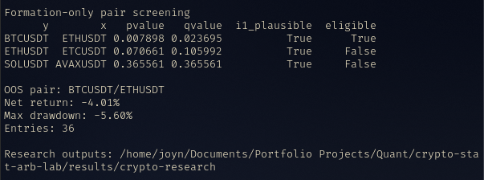
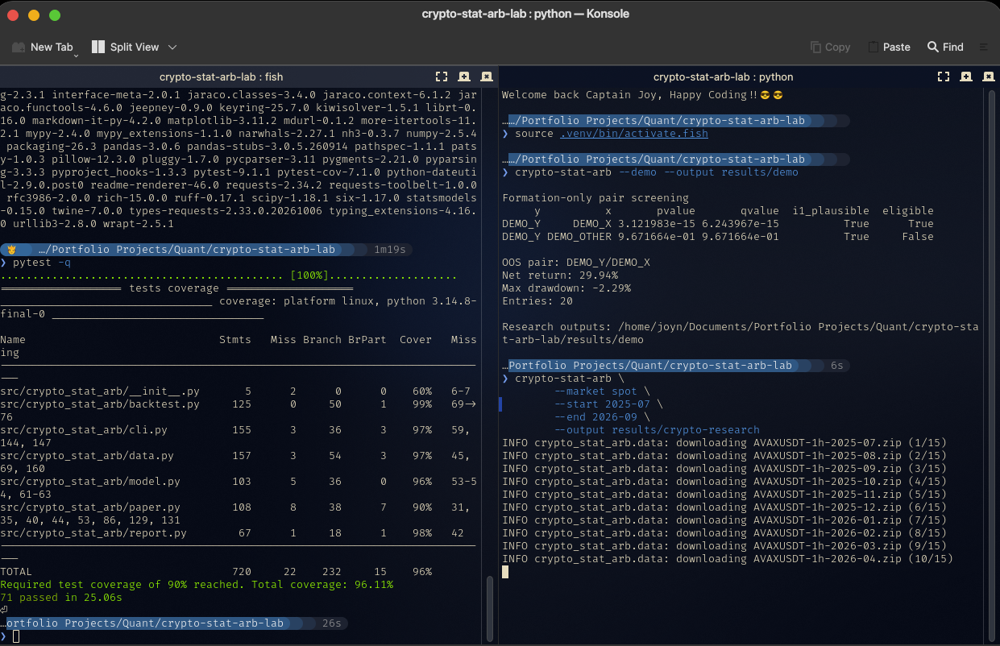

# Crypto Statistical Arbitrage Lab


[](https://github.com/astral-sh/ruff)

[](LICENSE)

**Cointegration, mean reversion, and actual backtest accounting for crypto pairs.**

I built this to find out whether two crypto markets that move together also share a tradeable long-run relationship. The distinction matters. A strong correlation can look impressive and still be useless for pairs trading.

This repository takes pairs from a list I choose upfront, estimates their relationship using **training data only**, generates mean-reversion signals and measures what happens in the untouched part of the history. It also checks how much the result changes after fees and slippage. If no pair passes the screening rules, the experiment stops there.

This is research software. It doesn't place orders, handle real exchange balances, or promise returns.

## What works

- Download and cache Binance hourly spot or USD-M perpetual klines, or read local CSVs.
- Verify every downloaded archive against the SHA-256 checksum Binance publishes next to it.
- Recognize historical millisecond and microsecond timestamps.
- Refuse gaps in the shared hourly data rather than filling prices that never existed.
- Screen predefined pairs using Engle-Granger, ADF diagnostics, and multiple-testing-adjusted p-values.
- Estimate the hedge ratio on formation only, then freeze it out of sample.
- Generate z-score entries/exits with stop, maximum holding time and cooldown.
- Execute the *previous close's* signal at the next hourly open.
- Account for rebalancing after positions drift, commissions, slippage, assumed borrowing and optional futures funding events.
- Save screening tables, position changes, hourly P&L, a chart, cost sensitivity, and a written report.
- Put a block-bootstrap confidence interval around the out-of-sample Sharpe instead of reporting a point estimate alone.
- Run optional expanding-window, nonoverlapping walk-forward folds.
- Run completely offline against reproducible synthetic data.

## Research results

I ran the baseline on real Binance spot hourly candles from July 2025 to September 2026. The model used 7,129 hourly observations for formation, then evaluated the selected pair on 3,839 later observations. Pair screening and the hedge ratio were fitted before the holdout started on 24 April 2026 (UTC).

Of the three pairs I screened, **BTCUSDT/ETHUSDT** was the only one that passed the training-period cointegration criteria. Its Engle-Granger p-value was 0.00790, with a Benjamini-Hochberg adjusted q-value of 0.02370. ETHUSDT/ETCUSDT and SOLUSDT/AVAXUSDT did not pass.

| Out-of-sample metric | Result |
| --- | ---: |
| Selected pair | BTCUSDT / ETHUSDT |
| Net return after modeled costs | **-4.01%** |
| Maximum drawdown | -5.60% |
| Annualized Sharpe (zero risk-free assumption) | -1.26 |
| Entries | 36 |
| Win rate across completed positions | 52.8% |
| Time with a position open | 41.2% |

The strategy returned **+6.84% before execution costs** in the zero-cost replay. With 6 bps in fees and 8 bps in slippage per traded dollar, the result dropped to **-4.01%**. That's the main finding for this run: the pair passed a statistical test, but I couldn't turn that relationship into a positive net return under the stated assumptions.



*Actual historical-data run, not live trading. The short leg is modeled using spot reference prices, so this does not establish an executable spot strategy. The complete run is in `results/crypto-research/` locally; `results/` is gitignored.*

I'm keeping the negative result. Cointegration is not a trading signal by itself, and the costs here matter a lot. A later experiment would need a genuinely untouched sample, realistic shorting or perpetual-futures mechanics, and venue-specific execution data before I would consider it tradeable.

## Tests and demo

The local run finished with **71 passing tests and 96.11% total coverage**. The test suite checks timing and leakage, data loading, accounting, funding conventions, state persistence, and end-to-end behavior. The synthetic demo also completed successfully, but its return is only a pipeline check, not evidence of a market edge.



*Left: test coverage. Right: synthetic demo output and the start of the real-data download. The demo's +29.94% result comes from generated data, not actual crypto trading.*

## Quick start

Python 3.10 or newer is enough. On Linux:

```bash
python -m venv .venv
source .venv/bin/activate
pip install -e '.[dev]'
pytest -q
crypto-stat-arb --demo --output results/demo
```

The demo is fake on purpose. It checks that the pipeline works. **The demo's performance is not market evidence.**

There is also a `Makefile` for the usual loop (`make setup`, `make check`, `make demo`, `make real`; `make help` lists the rest) and a `Dockerfile` if you would rather not install anything:

```bash
docker build -t crypto-stat-arb-lab .
docker run --rm -v "$PWD/results:/work/results" crypto-stat-arb-lab --demo --output results/docker-demo
```

## Run on actual crypto history

You don't need an exchange account or API keys to access Binance's public historical candles.

```bash
crypto-stat-arb \
  --market spot \
  --start 2025-07 --end 2026-09 \
  --output results/spot-baseline
```

The default predeclared candidates are ETHUSDT:ETCUSDT, BTCUSDT:ETHUSDT, and SOLUSDT:AVAXUSDT. These may fail stationarity/cointegration tests, and that's okay. To change the candidate hypotheses:

```bash
crypto-stat-arb --market spot --start 2025-07 --end 2026-09 \
  --pairs 'ETHUSDT:BTCUSDT,SOLUSDT:AVAXUSDT' \
  --output results/custom
```

Only fully published monthly archives work. September 2026 was selected so the example can run with finalized monthly files in October 2026.

Each monthly zip is checked against the `.CHECKSUM` file Binance publishes beside it before it is cached. A mismatch is an error, not a warning, and the bad file is not kept. `--no-verify` turns this off if you have a reason to.

## Using USD-M perpetuals

```bash
crypto-stat-arb --market um --start 2025-07 --end 2026-09 \
  --output results/perpetuals
```

That downloads **futures klines**, but the result isn't a complete realized futures return unless funding, costs and trading constraints are represented. Supply an independently collected and checked funding CSV:

```bash
crypto-stat-arb --market um --start 2025-07 --end 2026-09 \
  --funding-file data/my_funding.csv \
  --borrow-apr 0 --output results/perpetuals-funded
```

The funding CSV needs `timestamp,symbol,funding_rate`. `timestamp` must match an hourly UTC candle opening. Rate is a decimal fraction, not a percent. An omitted funding event is treated as zero, so **you must independently check the funding file is complete**. The program cannot infer whether an absent event is correct. See `docs/METHODOLOGY.md`.

## Own CSV files

Create `data/local/BTCUSDT.csv`, `data/local/ETHUSDT.csv`, etc. Each one needs these headers:

```csv
timestamp,open,close
2025-01-01T00:00:00Z,93450.20,93462.11
2025-01-01T01:00:00Z,93462.11,93480.90
```

The snippet only shows the format. You need enough real hourly observations for training and testing.

```bash
crypto-stat-arb --local-dir data/local \
  --pairs 'ETHUSDT:BTCUSDT' --output results/local
```

Only common timestamps are used, and any gap in the resulting hourly index causes an error. Missing values are not interpolated.

## Stress tests and walk-forward

```bash
crypto-stat-arb --demo --walk-forward --fold-bars 480 --output results/demo-walkforward
```

The main holdout remains fixed. In each walk-forward fold the regression and pair screening are refit using only observations available up to that fold. A fold can legitimately have no eligible pair.

## What is saved

| File | Meaning |
| --- | --- |
| `pair_screening_train_only.csv` | ADF, cointegration and adjusted p-values for training |
| `summary.json` | Settings, sample boundaries, selected pair, performance, bootstrap interval, package version |
| `out_of_sample_backtest.csv` | Timestamped gross/net returns, funding, execution costs, turnover, equity and drawdown |
| `position_changes.csv` | Open-of-bar entries, exits and reversals |
| `trade_ledger.csv` | Completed position holding periods and per-trade net returns |
| `cost_sensitivity.csv` | Replayed holdout at different *assumed* execution costs |
| `backtest.png` | Spread z-score, net equity, drawdown |
| `RESEARCH_REPORT.md` | Generated methodology/results/caveat summary |
| `walk_forward_folds.json` | Optional forward fold details |
| `walk_forward_returns.csv` | Optional forward fold return series when there are trades |

If the screen finds no eligible pair, the run writes screening, summary, and report, with **no invented trades**.

## My research rules

1. The holdout is for evaluation, not repeated parameter fishing.
2. No fitting the hedge ratio using future data.
3. No signal at a candle close gets filled before the next candle open.
4. No claiming live profitability from a spot-price shorting proxy.
5. An unprofitable but well-explained result is better than a backtest that hides its assumptions.

See [methodology](docs/METHODOLOGY.md) and [research log](docs/RESEARCH_LOG.md) for the full experiment details.

## Data source and acknowledgment

Binance publishes historical candles at [data.binance.vision](https://data.binance.vision/). See its [official public data documentation](https://github.com/binance/binance-public-data). These datasets are fetched when running real-market mode and are not redistributed in this repository. Check Binance data terms before any commercial use.

## What's deliberately outside this version

Live/paper exchange connectivity, smart order routing, position/margin liquidation simulation, level-2 microstructure, and verified trade execution are separate engineering and data-validation tasks. Implementing them without reliable quotes and instrument metadata would make the performance claims worse, not better.

## License

MIT for this code; third-party market data has its own terms.

## Read-only live paper signals

After a **real-data** backtest selects a pair, you can check the latest completed public exchange candles against that frozen model:

```bash
crypto-stat-arb-paper --market spot \
  --summary results/spot-baseline/summary.json \
  --state results/paper_state.json
```

Add `--watch --poll-seconds 60` to poll continuously while your terminal stays open. This feature uses Binance public REST klines, not a low-latency websocket feed. It never sends orders. It tracks signal state, **not** fills, equity, or account balances. The first run starts flat; later runs update the signal only when another hourly candle has closed. If you miss a bar, it stops rather than silently inventing a state transition. Delete or rename the state file to deliberately restart flat.

A delayed poll can miss the next open. For that reason, a live paper signal is **not** evidence of the historical next-open fill assumption being achievable. I would add actual exchange quotes and a dedicated paper execution simulator before treating it as an execution test.

## Explore the outputs in a notebook

`notebooks/01_research.ipynb` reads the saved experiment, plots equity and drawdown, and leaves space for my interpretation. Start with `results/demo`, then switch the notebook's path to a real run when you've downloaded historical candles. The small `examples/demo_run` folder is explicitly **synthetic**, not a trading track record.

## Automated tests

`pytest -q` runs the data parser, leakage guards, signal state, accounting, funding conventions, paper-state persistence and end-to-end assumptions. It also runs the CLI end to end on synthetic data, exercises the downloader against a fake HTTP server (404s, retries, cache hits, corrupted archives), and checks the no-eligible-pair path writes no trades. Coverage is enforced at 90% (currently 96%).

CI runs `ruff`, `mypy`, the test matrix on Python 3.10 through 3.13 (plus Windows and macOS on 3.12), a synthetic walk-forward run, and then builds the wheel and installs it into a clean environment. `pre-commit install` runs the same linters before each commit.

## Repository layout

```
src/crypto_stat_arb/
  data.py       Binance archive download, checksum verification, local CSV and funding readers
  model.py      formation-only screening (Engle-Granger, ADF, BH), frozen hedge ratio, z-score state machine
  backtest.py   next-open execution, drift-aware rebalancing, cost/borrow/funding accounting, metrics, bootstrap
  report.py     plots, JSON, cost stress replay, written research report
  cli.py        the experiment runner and walk-forward loop
  paper.py      read-only live signal monitor
tests/          71 tests; nothing touches the network
docs/           METHODOLOGY.md and the RESEARCH_LOG.md template
examples/       one synthetic run, so you can see the output shape without running anything
notebooks/      reads a saved run back for inspection
```
